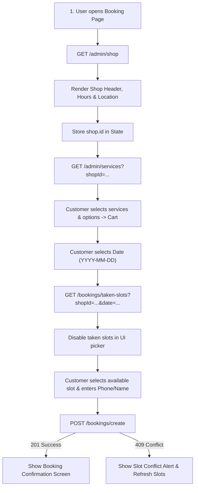

# 📖 Cherrybrush Booking & Admin API Specification

> **Target Audience:** Frontend engineers and AI agents scaffolding customer-facing booking portals and admin dashboards.  
> **Backend Implementation:** Express + MongoDB ([`admin.ts`](file:///c:/Users/vikra/Desktop/cherrybrush_to_do_list/artifacts/api-server/src/routes/admin.ts), [`booking.ts`](file:///c:/Users/vikra/Desktop/cherrybrush_to_do_list/artifacts/api-server/src/routes/booking.ts), [`adminAuth.ts`](file:///c:/Users/vikra/Desktop/cherrybrush_to_do_list/artifacts/api-server/src/lib/adminAuth.ts)).

---

## 1. Architectural Principles

1. **Public Read, Protected Write**:
   - Customers and admins read the **exact same public endpoints** to view shop details, business hours, and services.
   - Admin authentication (`Bearer <accessToken>`) is **only** required for mutations (editing shop, creating services, viewing private booking lists).
2. **Anchor Shop**:
   - The primary business email is **`cherrybrush.in@gmail.com`**.
   - Public shop queries (`GET /admin/shop`) automatically resolve to this shop by default without requiring hardcoded IDs.
3. **Privacy First**:
   - Slot availability (`GET /bookings/taken-slots`) exposes **zero PII** (only an array of booked time strings).
   - Full booking details (names, phone numbers, carts) are strictly locked behind `requireAdmin`.

---

## 2. Shared TypeScript Types

> 💡 **Tip for Frontend Agents:** Copy-paste this entire block directly into your frontend `types/booking.ts` or `types/api.ts`.

```typescript
// =========================================================================
// 1. SHOP & ADMIN TYPES
// =========================================================================

export type DaySchedule = string; // e.g. "10:00 AM – 7:00 PM" | "Closed"

export interface OpeningTimings {
  monday?: DaySchedule;
  tuesday?: DaySchedule;
  wednesday?: DaySchedule;
  thursday?: DaySchedule;
  friday?: DaySchedule;
  saturday?: DaySchedule;
  sunday?: DaySchedule;
}

export interface PublicShop {
  _id?: string;
  id?: string;
  email: string;
  role: "user" | "admin";
  shopName: string;
  openingTimings: OpeningTimings;
  location: string;
  phone: string;
  shopImages: string[]; // Cloudinary URLs
  createdAt?: string;
  updatedAt?: string;
}

export interface ShopUpdateRequest {
  shopName?: string;
  openingTimings?: OpeningTimings;
  location?: string;
  phone?: string;
  shopImages?: string[];
}

// =========================================================================
// 2. SERVICE & CATALOG TYPES
// =========================================================================

export interface ServiceFeature {
  name: string; // e.g. "Gel Polish", "Hair Wash"
  price: string; // e.g. "₹500", "Free"
  additive: boolean; // true = adds to base service price; false = replaces base
  required: boolean; // true = customer must select from this option group
  oneOrMany: number; // 1 = single choice; >1 = multiple selection (up to N)
}

export interface ServiceOptions {
  // Key: Group label (e.g. "Color", "Length", "Add-ons")
  // Value: Array of selectable features
  [featureGroupName: string]: ServiceFeature[];
}

export interface Service {
  _id?: string;
  id?: string;
  serviceName: string;
  basePrice?: number | string; // e.g. 500 or "₹500"
  serviceImages: string[];
  serviceType: string; // e.g. "Hair", "Nails", "Skin"
  serviceDuration: string; // e.g. "45 mins", "1.5 hours"
  serviceOptions: ServiceOptions;
  serviceDown: boolean; // true = temporarily unavailable / hidden
  shopId: string; // References PublicShop._id / id
  createdAt?: string;
}

export interface ServiceCreateRequest {
  shopId: string;
  serviceName: string;
  basePrice?: number | string;
  serviceImages?: string[];
  serviceType: string;
  serviceDuration: string;
  serviceOptions?: ServiceOptions;
  serviceDown?: boolean;
}

// =========================================================================
// 3. BOOKING TYPES
// =========================================================================

export type BookingStatus = "CONFIRMED" | "CANCELLED" | "COMPLETED";

export interface SelectedOption {
  featureName: string;
  price: string;
  additive: boolean;
}

export interface CartItem {
  serviceId: string; // References Service._id / id
  serviceName: string;
  selectedOptions: SelectedOption[];
  totalPrice: number;
}

export interface Booking {
  _id?: string;
  id?: string;
  customerName: string;
  customerPhone: string;
  shopId: string; // References PublicShop._id / id
  date: string; // Format: "YYYY-MM-DD"
  timeSlot: string; // e.g. "10:00 AM", "02:30 PM"
  cart: CartItem[];
  notes?: string;
  status: BookingStatus;
  createdAt?: string;
  deleted?: boolean;
}

export interface BookingCreateRequest {
  customerName: string;
  customerPhone: string;
  shopId: string;
  date: string; // Must match regex: ^\d{4}-\d{2}-\d{2}$
  timeSlot: string;
  cart: CartItem[];
  notes?: string;
}

// =========================================================================
// 4. AUTH & TOKEN TYPES
// =========================================================================

export interface AdminLoginRequest {
  email: string;
  password: string;
}

export interface AdminRegisterRequest {
  email: string;
  password: string;
  shopName: string;
  location: string;
  phone: string;
  openingTimings: OpeningTimings;
  shopImages?: string[];
  role?: "admin" | "superadmin";
}

export interface AdminTokenPayload {
  adminId: string;
  email: string;
  role: string;
  shopName: string;
}

export interface AuthTokens {
  accessToken: string; // Expires in 15m
  refreshToken: string; // Expires in 7d
  payload: AdminTokenPayload;
}

export interface LoginResponse extends AuthTokens {
  success: boolean;
  message: string;
  admin: PublicShop;
}

// =========================================================================
// 5. STANDARD API RESPONSE WRAPPERS
// =========================================================================

export interface ApiResponse<T> {
  success: boolean;
  message?: string;
  [key: string]: any;
}

export interface ApiErrorResponse {
  success: false;
  message: string | Record<string, string[]>; // Zod field errors or message
}
```

---

## 3. Authentication & Headers

Protected routes require the `Authorization` header containing the JWT access token:

```http
Authorization: Bearer <accessToken>
```

- Token lifetimes: **15 minutes** for access tokens, **7 days** for refresh tokens.
- If missing, malformed, or expired, returns `401 Unauthorized`.

---

## 4. Complete Endpoints Reference

### A. Shop & Admin Management

#### 1. `GET /admin/shop` — View Shop Profile

- **Access:** **Public** (Both Customers & Admins)
- **Aliases:** `GET /admin/shop`, `GET /admin/shop/:id`, `GET /admin/get-shop`
- **Query Params (Optional):**
  - `?email=` — Search by email (defaults to `cherrybrush.in@gmail.com`)
  - `?id=` — Search by ID
- **Success Response (`200 OK`):**
  ```json
  {
    "success": true,
    "shop": {
      "id": "67...",
      "_id": "67...",
      "email": "cherrybrush.in@gmail.com",
      "role": "admin",
      "shopName": "Cherrybrush Studio",
      "openingTimings": {
        "monday": "10:00 AM – 7:00 PM",
        "tuesday": "10:00 AM – 7:00 PM",
        "sunday": "Closed"
      },
      "location": "Mumbai, India",
      "phone": "+91 9876543210",
      "shopImages": ["https://res.cloudinary.com/.../shop1.jpg"],
      "createdAt": "2026-11-20T10:00:00.000Z"
    }
  }
  ```

---

#### 2. `PUT /admin/shop` — Update Shop Profile

- **Access:** **Protected (Admin only)**
- **Headers:** `Authorization: Bearer <accessToken>`
- **Content-Type:** `application/json` OR `multipart/form-data`
- **Direct Image Uploads:** Attach raw files to field `images` (up to 10 files). They are automatically uploaded directly to Cloudinary (`cherrybrush/shops/<shopName>`) and their URLs added to `shopImages`.
- **Request Body:** Partial `ShopUpdateRequest`
  ```json
  {
    "phone": "+91 9123456789",
    "location": "Bandra West, Mumbai",
    "openingTimings": {
      "monday": "09:30 AM – 08:00 PM",
      "sunday": "Closed"
    }
  }
  ```
- **Success Response (`200 OK`):**
  ```json
  {
    "success": true,
    "message": "Shop updated successfully",
    "shop": { ...updatedPublicShop }
  }
  ```

---

#### 3. `POST /admin/register` — Admin Registration

- **Access:** **Restricted / Server-to-Server**
- **Content-Type:** `application/json` OR `multipart/form-data`
- **Direct Image Uploads:** Attach raw files to field `images` (up to 10 files). Uploaded directly to Cloudinary and added to `shopImages`.
- **Request Body:** `AdminRegisterRequest`
- **Success Response (`201 Created`):**
  ```json
  {
    "success": true,
    "message": "Admin registered successfully",
    "accessToken": "...",
    "refreshToken": "...",
    "admin": { ...publicShopDetails }
  }
  ```

---

#### 4. `POST /admin/login` — Admin Authentication

- **Access:** **Public**
- **Request Body:** `AdminLoginRequest`
  ```json
  {
    "email": "cherrybrush.in@gmail.com",
    "password": "yourPassword123"
  }
  ```
- **Success Response (`200 OK`):**
  ```json
  {
    "success": true,
    "message": "Login successful",
    "accessToken": "eyJhbGciOi...",
    "refreshToken": "eyJhbGciOi...",
    "payload": {
      "adminId": "67...",
      "email": "cherrybrush.in@gmail.com",
      "role": "admin",
      "shopName": "Cherrybrush Studio"
    },
    "admin": { ...publicShopDetails }
  }
  ```

---

#### 4a. `POST /admin/refresh-token` — Silent Token Refresh

- **Access:** **Public** (No auth required)
- **Request Body (Optional if using cookies):**
  ```json
  { "refreshToken": "..." }
  ```
- **Cookie Support:** Reads `admin_refresh` cookie automatically (`credentials: "include"`).
- **Success Response (`200 OK`):**
  ```json
  {
    "success": true,
    "message": "Tokens refreshed successfully",
    "accessToken": "<new 15m JWT>",
    "refreshToken": "<new 7d JWT>"
  }
  ```
  > Also sets fresh `admin_access` + `admin_refresh` cookies automatically.
- **Failure Responses (`401 Unauthorized`):**
  - `{ "success": false, "message": "Refresh token invalid or expired. Please log in again." }`
  - `{ "success": false, "message": "No refresh token provided. Please log in again." }`
  - `{ "success": false, "message": "Admin account not found. Please log in again." }`

---

#### 4b. `POST /admin/logout` — Admin Sign Out

- **Access:** **Protected** (Requires valid `admin_access` cookie or `Authorization: Bearer <accessToken>`)
- **Request Body:** None
- **Success Response (`200 OK`):**
  ```json
  {
    "success": true,
    "message": "Logged out successfully"
  }
  ```
  > Clears both `admin_access` and `admin_refresh` cookies server-side.
- **Failure Response (`401 Unauthorized`):**
  ```json
  { "success": false, "message": "Not authenticated. Please log in." }
  ```

---

#### 5. `POST /admin/upload-shop-images` — Standalone Shop Image Upload

- **Access:** **Protected (Admin only)**
- **Headers:** `Authorization: Bearer <accessToken>`
- **Content-Type:** `multipart/form-data`
- **Form Field:** `images` (up to 10 files)
- **Optional Body Field:** `shopName` (string)
- **Success Response (`200 OK`):**
  ```json
  {
    "success": true,
    "shopName": "Cherrybrush Studio",
    "imageUrls": [
      "https://res.cloudinary.com/.../cherrybrush/shops/.../image1.jpg"
    ]
  }
  ```

---

### B. Services Catalog

#### 6. `GET /admin/services` — Fetch Available Services

- **Access:** **Public**
- **Query Params:**
  - `?shopId=<id>` _(Recommended)_: Filters services belonging to a specific shop.
  - `?includeDown=true` _(Admin only)_: Shows disabled/hidden services. Default is `false` (customers only see active services).
- **Success Response (`200 OK`):**
  ```json
  {
    "success": true,
    "services": [
      {
        "_id": "SVC_m5l2a1...",
        "id": "SVC_m5l2a1...",
        "serviceName": "Classic Haircut & Styling",
        "serviceType": "Hair",
        "serviceDuration": "45 mins",
        "serviceDown": false,
        "shopId": "67...",
        "serviceImages": ["https://res.cloudinary.com/.../cut.jpg"],
        "serviceOptions": {
          "Styling Choice": [
            {
              "name": "Blow Dry",
              "price": "₹300",
              "additive": true,
              "required": true,
              "oneOrMany": 1
            },
            {
              "name": "Curling",
              "price": "₹500",
              "additive": true,
              "required": false,
              "oneOrMany": 1
            }
          ]
        },
        "createdAt": "2026-11-21T12:00:00.000Z"
      }
    ]
  }
  ```

---

#### 7. `POST /admin/services/create` — Create Service

- **Access:** **Protected (Admin only)**
- **Headers:** `Authorization: Bearer <accessToken>`
- **Content-Type:** `application/json` OR `multipart/form-data`
- **Direct Image Uploads:** Attach raw files to field `images` (up to 10 files). Uploaded directly to Cloudinary (`cherrybrush/services/<serviceName>`) and added to `serviceImages`.
- **Request Body:** `ServiceCreateRequest`
- **Success Response (`201 Created`):**
  ```json
  {
    "success": true,
    "service": { ...createdService }
  }
  ```

---

#### 8. `POST /admin/upload-service-images` — Standalone Service Image Upload

- **Access:** **Protected (Admin only)**
- **Headers:** `Authorization: Bearer <accessToken>`
- **Content-Type:** `multipart/form-data`
- **Form Field:** `images` (up to 10 files)
- **Optional Body Field:** `serviceName` (string)
- **Success Response (`200 OK`):**
  ```json
  {
    "success": true,
    "serviceName": "Hair Spa",
    "imageUrls": [
      "https://res.cloudinary.com/.../cherrybrush/services/.../image1.jpg"
    ]
  }
  ```

---

### C. Booking System

#### 7. `GET /bookings/taken-slots` — Check Slot Availability

- **Access:** **Public** (Zero customer PII exposed)
- **Query Params (Both Required):**
  - `date=YYYY-MM-DD` (e.g. `2026-11-25`)
  - `shopId=<id>` (e.g. `67...`)
- **Purpose:** Frontend date/time picker uses this list to disable or grey-out taken time slots in the calendar.
- **Success Response (`200 OK`):**
  ```json
  {
    "success": true,
    "takenSlots": ["10:00 AM", "01:30 PM", "04:00 PM"]
  }
  ```

---

#### 8. `POST /bookings/create` — Confirm Booking

- **Access:** **Public**
- **Request Body:** `BookingCreateRequest`
  ```json
  {
    "customerName": "Jane Doe",
    "customerPhone": "+91 9876543210",
    "shopId": "67...",
    "date": "2026-11-25",
    "timeSlot": "11:30 AM",
    "cart": [
      {
        "serviceId": "SVC_m5l2a1...",
        "serviceName": "Classic Haircut & Styling",
        "selectedOptions": [
          { "featureName": "Blow Dry", "price": "₹300", "additive": true }
        ],
        "totalPrice": 800
      }
    ],
    "notes": "First time visit, sensitive scalp."
  }
  ```
- **Success Response (`201 Created`):**
  ```json
  {
    "success": true,
    "message": "Booking confirmed!",
    "booking": {
      "customerName": "Jane Doe",
      "customerPhone": "+91 9876543210",
      "shopId": "67...",
      "date": "2026-11-25",
      "timeSlot": "11:30 AM",
      "cart": [...],
      "notes": "First time visit, sensitive scalp.",
      "status": "CONFIRMED",
      "deleted": false,
      "createdAt": "2026-11-22T13:00:00.000Z"
    }
  }
  ```
- **Conflict Error (`409 Conflict`):**
  ```json
  {
    "success": false,
    "message": "This time slot is already booked. Please choose another."
  }
  ```

---

#### 9. `GET /bookings/get-bookings` — View All Bookings

- **Access:** **Protected (Admin only)**
- **Headers:** `Authorization: Bearer <accessToken>`
- **Query Params (Optional):**
  - `?date=YYYY-MM-DD`
  - `?shopId=<id>`
- **Success Response (`200 OK`):**
  ```json
  {
    "success": true,
    "bookings": [
      {
        "_id": "67...",
        "customerName": "Jane Doe",
        "customerPhone": "+91 9876543210",
        "shopId": "67...",
        "date": "2026-11-25",
        "timeSlot": "11:30 AM",
        "cart": [...],
        "status": "CONFIRMED",
        "createdAt": "..."
      }
    ]
  }
  ```

---

## 5. Frontend Implementation Flowchart


